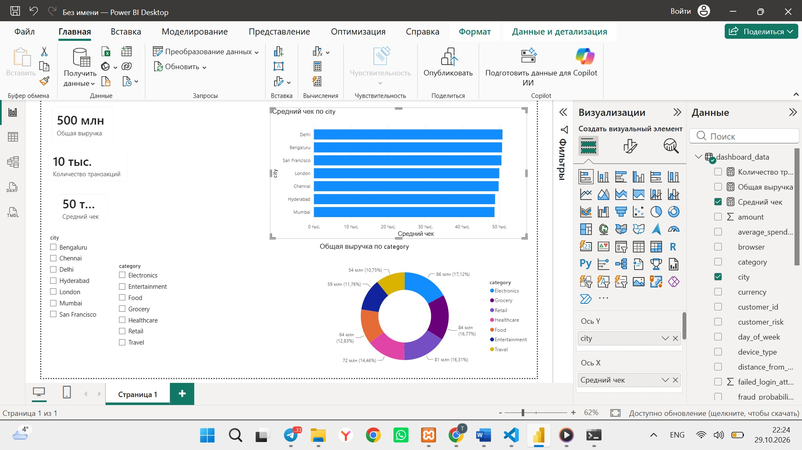

# Сквозной проект «Аналитика бизнес-показателей»: Гео-аналитика поведения клиентов

## 📌 Summary
1. **Разница в тратах по городам отсутствует:** средний чек (AOV) во всех 7 городах находится в узком диапазоне (48–50 тыс. INR), а гипотеза о разнице в категории Food не подтвердилась (p-value = 0.115).
2. **Лидерство по выручке обусловлено базой клиентов:** Дели приносит больше всего денег не из-за высоких чеков, а из-за наибольшего числа активных клиентов.
3. **Демография не предсказывает траты:** модель регрессии на основе города, возраста и дохода показала R² = 0.0027.

---

## 1. Постановка задачи

**Бизнес-проблема:** Компания не понимает, различается ли потребительское поведение клиентов в разных городах. Из-за этого маркетинг и продукт не могут таргетировать предложения по регионам, а финансы — строить корректный прогноз выручки.

**Цель:** Сравнить потребительское поведение клиентов (средний чек, частоту и сумму трат) в разрезе городов и построить модель прогноза месячных трат клиента.

**Гипотезы:**
- H1. Средний чек в категории Food в городе X статистически значимо выше, чем в остальных городах.
- H2. Частота и сумма транзакций различаются между городами.
- H3. Город, категория мерчанта, возраст клиента и тип карты значимо влияют на месячные траты клиента.

**KPI / метрики:** AOV (средний чек), ARPU (средние месячные траты на клиента), Транзакций на клиента, Retention по когортам, Доля платящих клиентов.

**Стейкхолдеры:** Маркетинг (региональный таргетинг), Продукт (офферы), Финансы (прогноз выручки).

**Оговорка о данных:** Датасет синтетический. Города: Mumbai, Delhi, Bengaluru, London, San Francisco, Chennai, Hyderabad. Валюта — INR. Категории: Travel, Healthcare, Entertainment, Retail, Electronics, Food, Grocery.

---

## 2. Данные

- **customers.csv** — 1000 клиентов (возраст, город, доход, кредитный рейтинг и др.)
- **cards.csv** — 1200 карт (тип, лимит, утилизация и др.)
- **devices.csv** — 1500 устройств (тип, ОС, биометрия и др.)
- **merchants.csv** — 200 мерчантов (категория, город, выручка и др.)
- **transactions.csv** — ~78 000 транзакций (время, сумма, категория, is_fraud и др.)

**Связи:** transactions.customer_id → customers.customer_id, transactions.merchant_id → merchants.merchant_id.

---

## 3. Структура репозитория

- README.md
- LICENSE
- requirements.txt
- 1 pet-proekt Power BI.pbix (Дашборд в Power BI)
- geo-analytics.ipynb (Jupyter Notebook)
- data/raw/ (5 исходных csv)
- images/dashboard.jpg (Скриншот для README)
- sql/queries.sql (SQL-запросы)
- src/build_db.py (Скрипт сборки БД)

---

## 4. Этапы проекта

1. Постановка задачи (этот README)
2. Сбор и выгрузка (SQL: JOIN, CTE, оконные функции, агрегаты)
3. Предобработка (Pandas: пропуски, дубли, типы)
4. EDA (распределения, корреляции, сегменты)
5. Расчёт метрик (AOV, ARPU, Retention, доля платящих)
6. Прогноз (LinearRegression, R², MAE)
7. Проверка гипотез (T-тест / U-тест, p-value)
8. Визуализация (Power BI дашборд)
9. Выводы и рекомендации (3–5 шагов для бизнеса)

---

## 5. Стек

- **Базы данных:** MySQL (phpMyAdmin)
- **Язык и анализ данных:** Python (pandas, numpy)
- **Визуализация:** Matplotlib, Seaborn, Power BI
- **Статистика и ML:** SciPy, Scikit-learn

---

## 6. Как запустить

1. Установите зависимости: pip install -r requirements.txt
2. Для просмотра анализа откройте Jupyter Notebook (файл .ipynb в корне проекта).
3. Для просмотра дашборда откройте файл 1 pet-proekt Power BI.pbix в программе Power BI Desktop.

---

## 7. Проверка гипотез

На основе проведенного анализа данных по 7 городам (Delhi, Mumbai, Bengaluru, Chennai, Hyderabad, San Francisco, London), мы выявили следующие закономерности:

1. **По общей выручке лидирует Дели (80 млн INR), но разница с другими городами невелика (20-25%).** Это связано с тем, что в Дели просто больше клиентов (162 чел. против 129 в Лондоне).
2. **Средний чек (AOV) практически одинаков во всех городах:** от 48 700 INR до 50 800 INR. Разница составляет всего 4%, что находится в пределах статистической погрешности.
3. **Сезонность:** Пик потребительской активности приходится на Сентябрь-Октябрь 2025 и Январь 2026. В Декабре 2025 наблюдается сильный спад среднего чека на одного клиента (ARPU падает до 61 736 INR).
4. **Гипотеза H1 (о разнице в чеках на еду) НЕ ПОДТВЕРДИЛАСЬ.** Несмотря на то, что в Сан-Франциско средний чек в категории Food визуально выше (50 254 INR), чем в Бенгалуру (45 327 INR), тест Манна-Уитни показал p-value = 0.115 (больше 0.05).
5. **Модель машинного обучения** (Linear Regression) для прогноза трат показала очень низкий R² = 0.0027. Демографические данные не могут предсказать будущие траты клиента. Для точного прогноза нужны транзакционные признаки.

---

## 8. Визуализация (Дашборд)

Для бизнеса был собран интерактивный дашборд в Power BI. Он позволяет в реальном времени фильтровать данные по городам и категориям, а также отслеживать ключевые метрики: общую выручку, количество транзакций и средний чек.

Основные элементы дашборда:
- **KPI-карточки:** Общая выручка, Количество транзакций, Средний чек.
- **График по городам:** Сравнение среднего чека по 7 городам.
- **Кольцевая диаграмма:** Распределение выручки по категориям мерчантов.
- **Срезы (Фильтры):** Возможность отфильтровать данные по конкретному городу или категории.

---

## 9. Выводы и рекомендации

На основе всех этапов анализа я сформулировала 4 конкретных шага для бизнеса:

1. **Не сегментировать маркетинг по городам.** Так как средний чек и поведение везде одинаковые, нет смысла делать разные ценовые предложения. Единая стратегия будет эффективнее.
2. **Увеличить бюджеты на привлечение в Дели и Ченнаи.** Там самое большое количество клиентов.
3. **Запускать промо-акции в Декабре.** В декабре средний ARPU падает. Скидки помогут поднять чек.
4. **Внедрить систему прогнозирования на основе истории покупок.** Нужно собирать данные о том, что и когда клиент покупал раньше.