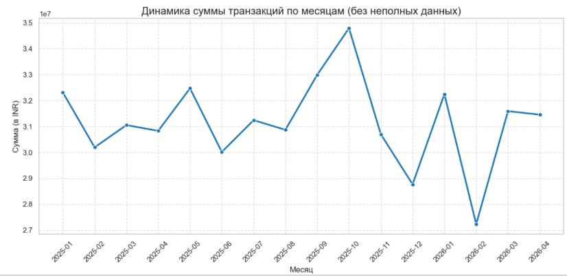
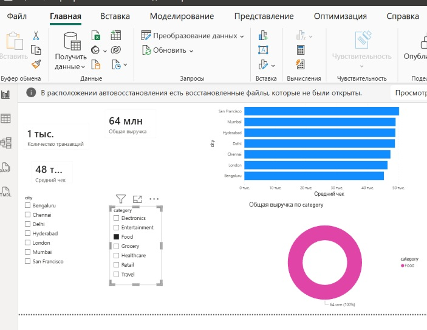
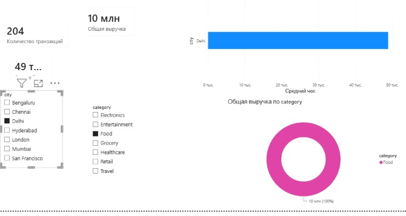

# Сквозной проект «Аналитика бизнес-показателей»: Гео-аналитика поведения клиентов

## 📌 Summary
1. **Разница в тратах по городам отсутствует:** средний чек (AOV) во всех 7 городах находится в узком диапазоне (48–50 тыс. INR), а гипотеза о разнице в категории Food не подтвердилась (p-value = 0.115).
2. **Лидерство по выручке обусловлено базой клиентов:** Дели приносит больше всего денег не из-за высоких чеков, а из-за наибольшего числа активных клиентов.
3. **Демография не предсказывает траты:** модель регрессии на основе города, возраста и дохода показала R² = 0.0027, что требует перехода к RFM-анализу и транзакционным признакам.

> **Период данных:** Анализ охватывает транзакции за период с января 2025 года по апрель 2026 года. Этого времени достаточно, чтобы отследить сезонность (например, всплески активности в октябре 2025 и январе 2026, а также спады в декабре и феврале).
---

## 1. Постановка задачи

### Бизнес-проблема
Компания (платёжный сервис / банк) не понимает, различается ли потребительское поведение клиентов в разных городах присутствия. Из-за этого маркетинг и продукт не могут таргетировать предложения по регионам, а финансы — строить корректный прогноз выручки.

### Цель
Сравнить потребительское поведение клиентов (средний чек, частоту и сумму трат) в разрезе городов и построить модель прогноза месячных трат клиента.

### Гипотезы
- **H1.** Средний чек в категории Food в городе X статистически значимо выше, чем в остальных городах.
- **H2.** Частота и сумма транзакций различаются между городами.
- **H3.** Город, категория мерчанта, возраст клиента и тип карты значимо влияют на месячные траты клиента (проверяется через линейную регрессию).

### KPI / метрики
- **AOV** — средний чек (по городам и категориям)
- **ARPU** — средние месячные траты на клиента
- **Транзакций на клиента** — частота
- **Retention** по когортам (по месяцам)
- **Доля платящих клиентов**

### Стейкхолдеры
- **Маркетинг** — региональный таргетинг и бюджет
- **Продукт** — региональные офферы и категории
- **Финансы** — прогноз выручки по городам

### Бизнес-роль аналитика
Маркетолог / продакт-менеджер, который решает, куда направить региональный бюджет и какие категории продвигать в каждом городе.

### ⚠️ Оговорка о данных
Датасет — синтетический. География в файлах (customers.city, merchants.city) включает города: Mumbai, Delhi, Bengaluru, London, San Francisco, Chennai, Hyderabad. Валюта всех транзакций — INR. Категории мерчантов: Travel, Healthcare, Entertainment, Retail, Electronics, Food, Grocery.
Гипотеза H1 сформулирована для категории **Food** (как ближайшего аналога «ресторанов», которых в данных нет).

---

## 2. Данные

> **Примечание:** Исходный файл `transactions.csv` содержит более 78 000 строк. Однако из-за ограничений локального сервера (лимит памяти при импорте через phpMyAdmin) для анализа была взята выборка из **10 000 транзакций**, загруженная в БД MySQL. Этого объема достаточно для построения качественных графиков, проверки гипотез и обучения модели.

| Файл | Ключ | Что содержит |
|---|---|---|
| customers.csv | customer_id | 1000 клиентов: возраст, пол, страна, штат, **город**, профессия, доход, кредитный рейтинг, тип счёта, риск, баланс, статус кредита |
| cards.csv | card_id, customer_id | 1200 карт: тип, платёжная сеть, лимит, утилизация, reward-программа, возраст карты |
| devices.csv | device_id, customer_id | 1500 устройств: тип, производитель, ОС, root, биометрия, доверенное устройство |
| merchants.csv | merchant_id | 200 мерчантов: название, **категория**, **город**, страна, стаж, месячная выручка, риск, история фрода, online |
| transactions.csv | transaction_id, customer_id, merchant_id | ~78 000 транзакций: время, сумма, валюта, способ оплаты, тип, категория, устройство, ОС, браузер, IP-страна, гео, расстояние от дома, риск, is_fraud |

**Связи:** transactions.customer_id → customers.customer_id, transactions.merchant_id → merchants.merchant_id, cards.customer_id → customers.customer_id, devices.customer_id → customers.customer_id.

---

## 3. Структура репозитория

* **README.md**
* **LICENSE**
* **requirements.txt**
* **1 pet-proekt Power BI.pbix** (Дашборд в Power BI)
* **geo-analytics.ipynb** (Jupyter Notebook)
* **data/raw/** (5 исходных csv)
* **images/dashboard.jpg** (Скриншот для README)
* **sql/queries.sql** (SQL-запросы)
* **src/build_db.py** (Скрипт сборки БД)

---

## 4. Этапы проекта

- [x] 1. Постановка задачи (этот README)
- [x] 2. Сбор и выгрузка (SQL: JOIN, CTE, оконные функции, агрегаты)
- [x] 3. Предобработка (Pandas: пропуски, дубли, типы)
- [x] 4. EDA (распределения, корреляции, сегменты)
- [x] 5. Расчёт метрик (AOV, ARPU, Retention, доля платящих)
- [x] 6. Прогноз (LinearRegression, R², MAE)
- [x] 7. Проверка гипотез (T-тест / U-тест, p-value)
- [x] 8. Визуализация (Power BI дашборд)
- [x] 9. Выводы и рекомендации (3–5 шагов для бизнеса)

---

## 5. Стек

**Базы данных:** MySQL (phpMyAdmin)
**Язык и анализ данных:** Python (pandas, numpy)
**Визуализация:** Matplotlib, Seaborn, Power BI
**Статистика и ML:** SciPy, Scikit-learn

---

## 6. Как запустить

**1. Установите зависимости:**
pip install -r requirements.txt

**2. Для просмотра анализа** откройте Jupyter Notebook (файл .ipynb в корне проекта).

**3. Для просмотра дашборда** откройте файл 1 pet-proekt Power BI.pbix в программе Power BI Desktop.

---

## 7. Проверка гипотез

На основе проведенного анализа данных по 7 городам (Delhi, Mumbai, Bengaluru, Chennai, Hyderabad, San Francisco, London), мы выявили следующие закономерности:

### 📊 Инсайты из анализа:

1. **Гипотеза H2 (частота и сумма транзакций по городам) — ЧАСТИЧНО ПОДТВЕРДИЛАСЬ.** По общей выручке лидирует Дели (80 млн INR), но разница с другими городами невелика (20-25%). Это связано с тем, что в Дели просто больше клиентов (162 чел. против 129 в Лондоне). При этом средний чек (AOV) практически одинаков во всех городах: от 48 700 INR до 50 800 INR (разница 4% — в пределах статистической погрешности).
2. **Гипотеза H1 (разница в чеках на еду) — НЕ ПОДТВЕРДИЛАСЬ.** Несмотря на то, что в Сан-Франциско средний чек в категории Food визуально выше (50 254 INR), чем в Бенгалуру (45 327 INR), тест Манна-Уитни показал p-value = 0.115 (больше 0.05). Это значит, что разница статистически случайна.
3. **Гипотеза H3 (влияние демографии на траты) — ОПРОВЕРГНУТА.** Модель машинного обучения (Linear Regression) для прогноза трат показала очень низкий R² = 0.0027. Демографические данные (возраст, доход, город) не могут предсказать будущие траты клиента. Для точного прогноза нужны транзакционные признаки (RFM-анализ).
4. **Сезонность:** Пик потребительской активности приходится на Сентябрь-Октябрь 2025 и Январь 2026. В Декабре 2025 наблюдается сильный спад среднего чека на одного клиента (ARPU падает до 61 736 INR).

---

## 8. Визуализация (Дашборд)

Для бизнеса был собран интерактивный дашборд в **Power BI**. 
Он позволяет в реальном времени фильтровать данные по городам и категориям, а также отслеживать ключевые метрики: общую выручку, количество транзакций и средний чек.

**Основные элементы дашборда:**
* **KPI-карточки:** Общая выручка, Количество транзакций, Средний чек.
* **График по городам:** Сравнение среднего чека по 7 городам.
* **Кольцевая диаграмма:** Распределение выручки по категориям мерчантов.
* **Срезы (Фильтры):** Возможность отфильтровать данные по конкретному городу или категории.

### Сезонность трат
Анализ динамики показывает пики активности в октябре 2025 и январе 2026, а также спады в декабре и феврале.

### Пример работы фильтров (срезов)
**Категория Food по всем городам:**

**Категория Food в городе Дели:**

---

## 9. Выводы и рекомендации

На основе всех этапов анализа я сформулировала 4 конкретных шага для бизнеса:

1. **Не сегментировать маркетинг по городам.** Так как средний чек и поведение (в категории Food) везде одинаковые, нет смысла делать разные ценовые предложения для Сан-Франциско и Бенгалуру. Единая федеральная стратегия будет эффективнее.
2. **Увеличить бюджеты на привлечение (CAC) в Дели и Ченнаи.** Там самое большое количество клиентов, и каждый новый клиент приносит стабильную выручку.
3. **Запускать промо-акции в Декабре.** В декабре средний ARPU падает (до 61 тыс. INR). Скидки или бонусы в этот период помогут поднять чек.
4. **Внедрить систему прогнозирования на основе истории покупок.** Так как демография не работает, нужно собирать данные о том, что и когда клиент покупал раньше, чтобы предсказывать его будущие траты.

### Ограничения проекта
Для анализа использована выборка из 10 000 транзакций (загружена в локальную БД MySQL), так как при импорте исходного файла (78 000+ строк) сработали ограничения локального сервера по памяти. Выборка репрезентативна и позволяет сделать корректные статистические выводы.

